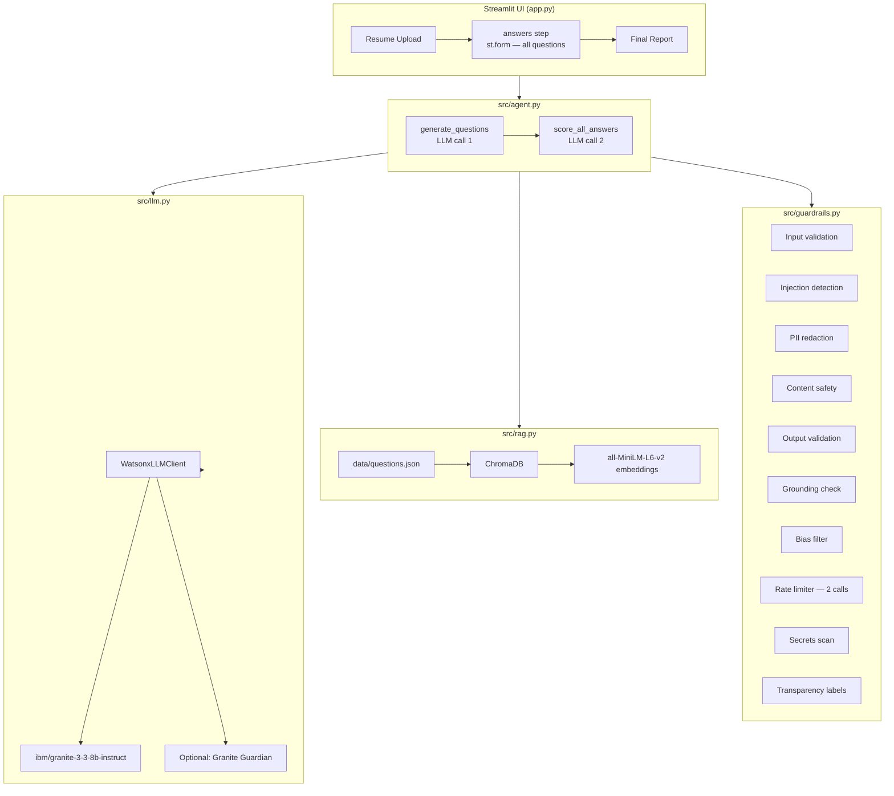

# Interview Trainer Agent 🎯

> **GitHub Repository:** [https://github.com/subhamkumar5456/Aicte-Interview-Trainer-Agent](https://github.com/subhamkumar5456/Aicte-Interview-Trainer-Agent)

A Streamlit web app that prepares you for job interviews using IBM Granite on
watsonx.ai, RAG-powered question generation, and a comprehensive 10-category
guardrail system.

---

## Features

- **Resume-aware questions** — Granite generates tailored interview questions
  grounded in your resume and a curated question bank (ChromaDB RAG).
- **Answer scoring** — Each answer is scored 0–10 with structured feedback,
  a model answer, and covered/missed key-point analysis.
- **Final report** — Average score, per-question bar chart, top strengths,
  and areas to improve.
- **10-category guardrail system** — Input validation, injection detection,
  PII redaction, content safety, output filtering, grounding checks, fairness
  filters, rate limiting, secrets protection, and transparency.
- **Privacy by default** — Nothing is written to disk; all data lives in
  Streamlit session state. One-click data clear.

---

## Supported Roles & Interview Types

| Role | Interview Types |
|------|----------------|
| Full-Stack Developer | technical, behavioral, mixed |
| AI/ML Engineer | technical, behavioral, mixed |
| Cybersecurity Analyst | technical, behavioral, mixed |

---

## Architecture

### Flow (2 LLM calls per interview session)

```
User fills resume + settings → clicks "Generate Interview"
   │
   ▼  LLM call 1 (temperature 0.5)
generate_questions()  ─── ONE call → all N questions at once
   │    RAG retrieves reference questions from ChromaDB first
   │    Pydantic validates GeneratedQuestions schema
   │    Per-question: bias filter, output safety, grounding check
   ▼
All N question cards rendered (st.form — no rerun per keystroke)
   │    Progress counter "X of N answered"
   │    Each card: question text, difficulty badge, "Why?" expander, text area
   │    "Submit all answers" button (disabled until ≥1 answer filled)
   ▼  Local guardrails on each answer (no LLM)
     validate_answer → check_injection → check_content_safety
     Empty → score 0 locally ("Not answered")
     Flagged → score 0 locally ("Blocked by safety check"), rest continues
   ▼  LLM call 2 (temperature 0.2)
score_all_answers()  ─── ONE call → full BatchScoringResponse
   │    Pydantic validates BatchScoringResponse schema
   │    Per-result: bias filter, secrets scan, output safety
   │    Average score computed in Python (not by the model)
   │    Truncated JSON → retry once → fallback to two smaller batches
   ▼
Final report: average score, bar chart, strengths, improvements,
              expandable per-question breakdown with model answers
```

### Component diagram



---

## Setup

### 1 — Prerequisites

- Python 3.11+ (tested on 3.14)
- An IBM Cloud account (Lite tier is free)

### 2 — Get watsonx.ai credentials (IBM Cloud Lite)

1. Sign up at [cloud.ibm.com](https://cloud.ibm.com) (Lite is free, no credit card).
2. Search for **"watsonx.ai"** in the catalog and create an instance.
3. Open the watsonx.ai console → **Projects** → create a new project.
4. Note your **Project ID** from the project settings URL.
5. Go to **Manage → Access (IAM)** → **API keys** → create an API key.
6. Your `WATSONX_URL` depends on the region:
   - US South: `https://us-south.ml.cloud.ibm.com`
   - EU Frankfurt: `https://eu-de.ml.cloud.ibm.com`
   - Tokyo: `https://jp-tok.ml.cloud.ibm.com`

### 3 — Clone and configure

```bash
git clone https://github.com/subhamkumar5456/Aicte-Interview-Trainer-Agent.git
cd interview-trainer
cp .env.example .env
# Edit .env with your credentials
```

`.env` contents:
```
WATSONX_API_KEY=your_ibm_cloud_api_key
WATSONX_PROJECT_ID=your_project_id
WATSONX_URL=https://us-south.ml.cloud.ibm.com
WATSONX_MODEL_ID=ibm/granite-3-3-8b-instruct
# Optional: GUARDIAN_MODEL_ID=ibm/granite-guardian-3-8b
```

### 4 — Install dependencies

```bash
python3 -m venv .venv
source .venv/bin/activate      # Windows: .venv\Scripts\activate
pip install -r requirements.txt
```

### 5 — Run

```bash
streamlit run app.py
```

The app will:
1. Validate your `.env` credentials on startup.
2. Build the ChromaDB vector index from `data/questions.json` on first run
   (takes ~30s the first time; cached thereafter).
3. Open in your browser at `http://localhost:8501`.

### 6 — Run tests

```bash
pytest tests/ -v
```

All tests run fully offline (no LLM calls required).

---

## Project Structure

```
interview-trainer/
├── app.py                  # Streamlit UI — batch flow (no business logic)
├── src/
│   ├── __init__.py
│   ├── config.py           # Env loading, constants, limits
│   │                         MAX_LLM_CALLS_PER_SESSION=2 for batch flow
│   ├── llm.py              # watsonx.ai client wrapper, retries, timeouts
│   │                         generate_batch_scoring() scales tokens with N
│   ├── rag.py              # ChromaDB build + retrieve
│   ├── agent.py            # generate_questions (call 1) + score_all_answers (call 2)
│   │                         + batch retry/fallback helpers
│   ├── guardrails.py       # All 10 guardrail categories; per-answer local checks
│   ├── schemas.py          # Pydantic v2 — incl. BatchScoringResponse schema
│   ├── prompts.py          # All prompt templates incl. BATCH_SCORING prompts
│   └── logging_utils.py    # Safe logging with PII redaction
├── data/
│   └── questions.json      # 45 original questions across 3 roles
├── tests/
│   ├── __init__.py
│   ├── test_guardrails.py  # Guardrail tests
│   ├── test_schemas.py     # Schema validation tests
│   └── test_agent_batch.py # Batch flow: 2 LLM calls, partial answers,
│                             flagged exclusion, truncated JSON fallback
├── .env.example
├── requirements.txt
└── README.md
```

---

## Guardrail Implementation Table

| # | Category | Where implemented | What it does |
|---|----------|-------------------|--------------|
| 1 | **Input validation** | `src/guardrails.py` — `validate_resume`, `validate_answer`, `validate_file_upload`, `sanitize_text` | Length limits (resume 50–6000 chars, answer 10–2000 chars), file size/extension/MIME allowlisting, control-char stripping, null-byte removal, unicode normalization. Each answer validated locally before batch call. |
| 2 | **Prompt injection & jailbreak** | `src/guardrails.py` — `check_injection`; `src/prompts.py` — `<answer id="...">` wrapper | 13 regex patterns. Each answer checked locally before batch call; flagged answers excluded and marked "Blocked by safety check". Untrusted text wrapped in `<answer id="...">` tags; system prompt instructs to ignore instructions inside them. |
| 3 | **PII & privacy** | `src/guardrails.py` — `redact_contact_details`, `contains_pii`; `src/logging_utils.py` — `redact_pii` | Masks email, phone, Aadhaar 12-digit, PAN, CC numbers. On-by-default redaction toggle before sending to LLM. Session-only storage; "Clear my data" button. Privacy notice in UI. |
| 4 | **Content safety & scope** | `src/guardrails.py` — `check_content_safety` | Blocks hate, sexual, illegal-activity, child-safety, offensive-cyber patterns. Off-topic detection. Self-harm input triggers supportive response. Each answer checked locally; unsafe answers excluded from batch. |
| 5 | **Output guardrails** | `src/guardrails.py` — `check_output`, `scan_for_secrets`; `src/schemas.py` — `BatchScoringResponse`; `src/llm.py` — `generate_json` repair loop; `src/agent.py` — batch fallback | Pydantic validation on both LLM responses; JSON repair retries; truncated batch → retry → two smaller batches. Per-result bias filter, secrets scan, output safety check. Exact question-ID coverage validated. No `unsafe_allow_html`. |
| 6 | **Grounding & hallucination** | `src/guardrails.py` — `check_grounding`; `src/prompts.py` system prompts | Heuristic proper-noun check against resume. System prompt instructs model not to invent details. Fallback flag when retrieval finds nothing. Visible disclaimer: "AI-generated; for practice only." |
| 7 | **Fairness & bias** | `src/guardrails.py` — `check_bias_in_output`, `filter_biased_sentences`; `src/schemas.py` — `InterviewQuestion.no_illegal_questions` | 50-term bias-word list. Biased sentences filtered per result. Illegal interview questions rejected at schema layer. System prompt instructs model to evaluate content only. |
| 8 | **Abuse, cost & reliability** | `src/guardrails.py` — `RateLimiter` (2 calls/session); `src/llm.py` — retry/timeout; `src/config.py` | **2-call session budget** (1 gen + 1 scoring). Token budget scales with N (N×250+300). 2s minimum interval, 45s hard timeout, exponential backoff (3 retries). Auth/quota/network errors surfaced with friendly messages. Graceful degradation when LLM is down. |
| 9 | **Secrets & security** | `src/logging_utils.py` — `redact_pii`; `src/config.py` — `_require`; `.gitignore` | No hardcoded credentials. `.env` excluded from git. API keys, full prompts, and raw model responses with PII never logged. Config validation fails fast with a clear message. |
| 10 | **Transparency & oversight** | `app.py` — "AI-generated" labels, "Why this question?" expander, safety badge, "Report a bad response" button | Every AI item labeled. Retrieved source IDs shown per question. Safety-check status badge on each response. Bad-response reports logged locally (redacted). Visible disclaimer on final report. Blocked answers shown with reason in report. |

---

## Configuration Reference

| Variable | Required | Default | Description |
|----------|----------|---------|-------------|
| `WATSONX_API_KEY` | ✅ | — | IBM Cloud API key |
| `WATSONX_PROJECT_ID` | ✅ | — | watsonx.ai project ID |
| `WATSONX_URL` | — | `https://us-south.ml.cloud.ibm.com` | Regional endpoint |
| `WATSONX_MODEL_ID` | — | `ibm/granite-3-3-8b-instruct` | Granite model ID |
| `GUARDIAN_MODEL_ID` | — | *(unset)* | Optional Granite Guardian model ID |

Additional tunables in `src/config.py`:

| Constant | Default | Description |
|----------|---------|-------------|
| `MAX_LLM_CALLS_PER_SESSION` | **2** | Per-session LLM call cap (1 gen + 1 scoring) |
| `MIN_SECONDS_BETWEEN_CALLS` | 2.0 | Minimum gap between calls |
| `RESUME_MAX_CHARS` | 6000 | Max resume length |
| `ANSWER_MAX_CHARS` | 2000 | Max answer length (truncates) |
| `LLM_TIMEOUT_SECONDS` | 45 | Hard timeout per LLM call |
| `LLM_MAX_RETRIES` | 3 | Exponential-backoff retries |
| `RAG_TOP_K` | 8 | Number of questions retrieved |
| `MAX_NEW_TOKENS_BATCH_SCORING_BASE` | 300 | Fixed token overhead for batch scoring |
| `MAX_NEW_TOKENS_BATCH_SCORING_PER_Q` | 250 | Additional tokens per answered question |

---

## Known Limitations & Design Choices

1. **Model ID** — Uses `ibm/granite-3-3-8b-instruct` by default. Check
   [IBM watsonx.ai Foundation Models](https://dataplatform.cloud.ibm.com/docs/content/wsj/analyze-data/fm-models.html)
   for the current list and update `WATSONX_MODEL_ID` accordingly.

2. **Language detection** — `langdetect` is probabilistic and may
   misidentify short texts. Non-English input produces a warning but is not
   blocked.

3. **Grounding heuristic** — The proper-noun hallucination check uses a
   simple heuristic (capitalized words ≥5 chars). It is a best-effort signal;
   the primary protection is the system-prompt instruction to Granite.

4. **Rate limiting** — The rate limiter is in-process and per-session (2 calls).
   It does not persist across server restarts or share state across multiple
   Streamlit users. For production, replace with Redis-backed counters.

5. **No server-side persistence** — Resumes and answers live only in
   Streamlit session state. If the browser tab is closed, all data is gone.
   This is intentional for privacy.

6. **SIGALRM timeout** — The hard 45s LLM timeout uses `signal.SIGALRM`,
   which is Unix-only. On Windows the timeout is best-effort (handled by the
   `tenacity` retry timeout instead).

7. **IBM Cloud Lite quota** — The Lite tier has a monthly token quota. If you
   hit it, the app shows a quota-exceeded message and stops making LLM calls.
   The 2-call session limit keeps token usage low per interview.

8. **Offline / no LLM** — The app loads and explains the problem gracefully
   if watsonx.ai is unreachable. All unit tests run fully offline.

9. **Batch scoring token budget** — The `max_new_tokens` for the scoring call
   scales as `N × 250 + 300` (max 7 questions → 2050 tokens). If the model
   still truncates, the agent retries once then splits the batch into two
   halves before giving up.

10. **Unanswered questions** — Questions left blank score 0 with feedback
    "Not answered", locally, without an LLM call. The progress counter warns
    the user before they submit.
